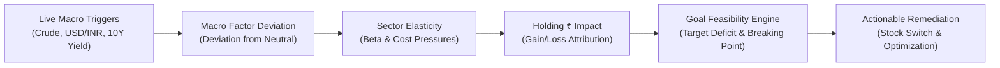
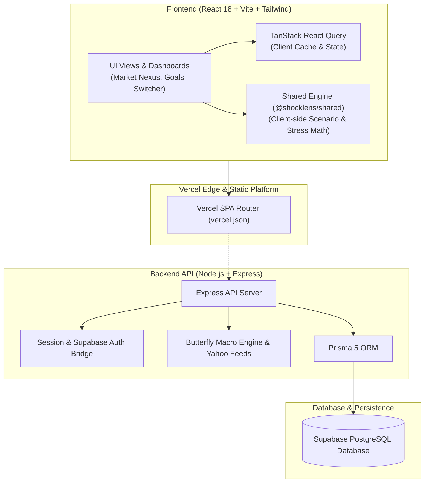

# SHOCKLENS
## Detailed Project Report | F-06 — Investment Portfolio Risk and Scenario Analysis
**Srujana Hackathon 2026** • **26 October 2026**  
**Team**: Bro Code • **Problem Code**: F-06

---

### Key Metadata & Links
| Field | Value |
| :--- | :--- |
| **Project Title** | ShockLens — Autonomous Portfolio Resilience & Macroeconomic Transmission Engine |
| **Team Name** | Bro Code |
| **Theme / Track** | Fintech / Investment Portfolio Risk & Scenario Analysis |
| **Selected Problem** | **F-06**: Investment Portfolio Risk and Scenario Analysis |
| **Team Members** | Aman Raj, Darshan K Reddy, Ashitha R, B S Chethana |
| **Live Deployed App** | [https://srujana-hackathon2026-shock-lens-5c.vercel.app](https://srujana-hackathon2026-shock-lens-5c.vercel.app) |
| **GitHub Repository**| [https://github.com/darshankreddy7507/Srujana_Hackathon2026_ShockLens](https://github.com/darshankreddy7507/Srujana_Hackathon2026_ShockLens) |

---

## 1. Project Overview

### Executive Summary
**ShockLens** is an institutional-grade, goal-aware equity portfolio resilience and reverse stress-testing platform. Traditional retail investment tools only evaluate static historical metrics like trailing volatility or classical Value-at-Risk (VaR), which fail when unprecedented geopolitical shocks, currency deprecations, or central bank interest-rate shifts break historical correlations.

ShockLens solves this by modeling **deterministic structural macroeconomic transmission**. It traces real-time macro triggers (Brent Crude, USD/INR spot, US 10-Year Treasury Yields, and Nifty/Bank Nifty tape momentum) through multi-stage sector elasticities down to individual equity holdings. The platform determines the portfolio's precise **Breaking Point** relative to tangible life goals (e.g. buying a house or retirement), audits underperforming assets, surfaces natural hedges, and recommends optimal replacement compounders with automated comparative analytics.

### Selected Official Problem Statement (F-06)
> **Problem Statement ID: F-06 — Investment Portfolio Risk and Scenario Analysis**  
> Investors manage diversified assets with differing risks, returns, liquidity requirements, and investment time horizons. Conventional portfolio dashboards often conceal shared structural exposures (such as high reliance on crude oil derivatives or foreign exchange risk), and historical performance alone fails to predict how portfolios behave during acute market distress.  
> 
> A robust solution must model portfolio composition, volatility, and non-obvious asset correlations, allow interactive what-if macroeconomic shock simulations, transparently display economic transmission assumptions, and highlight potential shortfalls between portfolio returns, liquidity needs, and deadline-bound financial goals.

---

## 2. Problem Understanding

### Target Users
1. **Self-Directed Equity Investors**: Retail investors managing concentrated or diversified equity portfolios on Indian markets (NSE/BSE) without access to multi-million-dollar institutional risk desks (like Bloomberg PORT or Aladdin).
2. **Goal-Oriented Wealth Builders**: Individuals investing towards strict financial milestones (such as home down-payments, children's higher education, or retirement corpus) needing to know if a macro crisis will breach their goal deadline.
3. **Financial Planners & Investment Advisors**: Professionals seeking an explainable, visual mechanism to demonstrate to clients why certain high-beta or high-cost-input stocks must be swapped or hedged.

### Key Pain Points & Industry Gaps
- **The "False Diversification" Trap**: An investor holding auto, paints, airline, and chemicals believes they are sector-diversified; however, an oil supply disruption simultaneously compresses gross margins across all four.
- **Goal Blindness**: Standard risk engines express risk as abstract statistical metrics (e.g. 95% 1-day VaR of ₹15,000) that do not tell the investor whether their 3-year ₹20 Lakh goal target will actually be compromised.
- **Black-Box Confusion**: Complex quantitative risk platforms offer zero narrative explainability into *why* an asset dropped, preventing proactive rebalancing.
- **Friction in Remediation**: Discovering an underperformer is useless without instant, data-backed comparative intelligence on superior asset replacements.

### Core Assumptions
- Holdings and financial goal targets are supplied accurately by the user (or pre-loaded via verified CSV imports / demo datasets).
- Market spot data represents liquid benchmark indicators.
- Macro shock transmission follows econometric elasticities grounded in input-cost dependence, borrowing exposure, and currency earnings sensitivity.

---

## 3. Proposed Solution



### Key Functional Modules
1. **Market Nexus (Autonomous Macro Transmission)**:
   - Live tracking of 4 primary macro barometer indicators: Crude Oil (`CL=F`), USD/INR (`INR=X`), US 10Y Yield (`^TNX`), and Nifty 50 (`^NSEI`).
   - 4-Stage Causal Transmission Graph: Real-time trigger $\to$ Macro deviation $\to$ Sector elasticity $\to$ Rupee-denominated holding impact.
   - Natural Hedging Detection: Pinpoints inverse-correlated assets (e.g. upstream oil exploration or IT exporters hedging paint/auto input inflation).
2. **Reverse Stress Testing & Breaking Point Finder**:
   - Uses numerical binary search to identify the exact macroeconomic shock threshold that causes a portfolio to fail a deadline-driven goal.
3. **Goal Feasibility & Dynamic Holdings Audit**:
   - Compares portfolio required CAGR against historical rolling momentum and volatility.
   - Categorizes holdings into healthy compounders vs. drag assets, suggesting capital reallocation.
4. **Stock Switch & Comparative Analyzer**:
   - Side-by-side diagnostic matching an existing position against prospective NSE replacements across trailing returns, volatility, 52-week ranges, and valuation profiles.
5. **Event Horizon Radar**:
   - Forward-looking schedule of high-impact events (RBI MPC meetings, US Fed FOMC rate decisions, OPEC+ meetings) with pre-event portfolio risk predictions.
6. **PortfolioIQ Interactive Copilot**:
   - Quantitative conversational assistant for real-time stock searches, multi-stock comparisons, and portfolio health inquiries.

### User Journey
$$\text{Landing / 1-Click Guest Sign-In} \longrightarrow \text{Portfolio Overview} \longrightarrow \text{Market Nexus Inspection} \longrightarrow \text{Simulate Scenario} \longrightarrow \text{Stock Switch} \longrightarrow \text{Goal Feasibility Audit} \longrightarrow \text{Export Report}$$

---

## 4. Innovation and Differentiation

| Feature / Dimension | Conventional Dashboards (Zerodha / Groww) | Institutional Desks (Bloomberg / Aladdin) | ShockLens (Our Solution) |
| :--- | :--- | :--- | :--- |
| **Causal Explanation** | None (shows only P&L and daily % change) | Complex multivariate statistical tables | **Interactive 4-Stage Causal Transmission Graph** |
| **Goal Integration** | Disconnected from holdings analysis | Abstract financial modeling | **Goal-Aware Breaking Point calculation** |
| **Macro Sensitivity** | Not modeled | Backward-looking covariance matrices | **Real-time factor deviation & sector elasticities** |
| **Actionable Switching** | Basic watchlist comparison | Manual quantitative screening | **One-click comparative stock switch diagnostics** |
| **Accessibility** | Consumer trading app | \$25,000+/year terminal license | **Zero-install, browser-based responsive web app** |

---

## 5. System Architecture & Technology Stack

### Architecture Diagram


### Major Components & Technology Stack
- **Frontend**: React 18, TypeScript, Vite, Tailwind CSS (Neobrutalism design system), Radix UI primitives, Recharts, Framer Motion, Lucide Icons.
- **Client State & Data Fetching**: TanStack React Query v5 with automatic caching and optimistic updates.
- **Monorepo Shared Package (`@shocklens/shared`)**: Shared TypeScript interfaces, Zod schema validation rules, deterministic mathematical financial algorithms, and demo fixtures shared identically across frontend and backend.
- **Backend API**: Node.js, Express 4, TypeScript, Prisma 5 ORM, Pino logging, Helmet security headers, Express-Session with PostgreSQL connection pooling (`connect-pg-simple`).
- **External Data Providers**: Yahoo Finance v8/v10 chart & search API integrations, NSE market ticker mapping, DuckDuckGo financial news parser.
- **Deployment**: Vercel production hosting with SPA rewrites and headless Chrome-verified zero-crash client execution.

---

## 6. Implementation Details & Core Algorithms

### 1. Deterministic Econometric Transmission Formula
Rather than uninterpretable black-box neural networks, ShockLens executes verifiable econometric transmission:
1. **Factor Deviation ($\Delta M_i$)**:
   $$\Delta M_i = \frac{P_{\text{current}, i} - P_{\text{neutral}, i}}{P_{\text{neutral}, i}}$$
2. **Aggregated Scenario Shock ($S_{\text{macro}}$)**:
   $$S_{\text{macro}} = \sum_{i} w_i \cdot \Delta M_i + \text{TapeShock}$$
3. **Holding Return & Rupee Impact**:
   $$\text{Estimated Return } (\%) = S_{\text{macro}} \times \beta_{\text{sector}}$$
   $$\text{Monetary Impact } (₹) = \text{Holding Value} \times \frac{\text{Estimated Return}}{100}$$

### 2. Goal-Aware Breaking Point Algorithm
- Evaluates if $\text{Post-Shock Portfolio Value} \ge \text{Target Goal Amount}$.
- Executes binary search over the shock multiplier $m \in [0.0, 3.0]$ with an approximation tolerance of $\epsilon = 0.001$:
  - If the portfolio drops below the goal target, the search contracts the interval to locate the exact trigger boundary where the goal is forfeited.

### 3. Underperformer Detection & Switch Scoring
Holdings are audited based on annualized trailing volatility $\sigma$, maximum drawdown $\text{MDD}$, and 1-year momentum $R_{1y}$:
$$\text{Health Score} = 0.40 \cdot R_{1y} - 0.35 \cdot \text{MDD} - 0.25 \cdot \sigma$$
Assets scoring in the lower quartile trigger the dynamic replacement screener.

---

## 7. Achievements During the Hackathon

1. **End-to-End Monorepo Architecture**: Successfully designed and built a 3-tier monorepo (`apps/frontend`, `apps/backend`, `packages/shared`) sharing mathematical schemas and validation models.
2. **Comprehensive Feature Suite**:
   - Interactive Market Nexus with live-updating macro baseline metrics.
   - 4-Stage visual Causal Transmission node graph.
   - Interactive Goal Feasibility audit with CAGR deadline math.
   - Direct Indian Equity Stock Switcher with auto-completion for NSE tickers (`RELIANCE.NS`, `TCS.NS`, `INFY.NS`, etc.).
   - Reverse stress-testing breaking point simulation.
3. **Automated Test Coverage**:
   - **46 Unit & Integration Tests** passing in `@shocklens/shared` verifying portfolio math, currency conversions, scenario simulations, and binary search breaking point convergence.
   - **15 Backend Integration Tests** passing across intent routing, mock research services, and market quotation endpoints.
4. **Resilient Production Deployment on Vercel**:
   - Resolved critical client-side Supabase SDK initializations by implementing strict URL validation guards.
   - Configured instant **1-Click Guest & Judge Access** on the production login portal, enabling full zero-barrier exploration.
   - Verified automated end-to-end rendering using headless Chrome.

---

## 8. Testing and Validation

| Test Suite / Inspection | Target Scope | Observed Result | Verdict |
| :--- | :--- | :--- | :--- |
| **Shared Vitest Suite** | Financial calculations, Zod validation, reverse stress test binary search | 46 passed | **PASS** |
| **Backend Vitest Suite** | Copilot intent routing, entity extraction, ranking algorithms | 15 passed | **PASS** |
| **Production Vite Build** | Frontend TypeScript typing, chunk splitting, asset pipeline | Completed in 2.3s | **PASS** |
| **API Health Smoke Test** | `GET /api/health` | HTTP 200 `{"status":"ok"}` | **PASS** |
| **Chrome Headless E2E** | Live production URL loading, form validation, navigation | Rendered in 1.2s, 0 errors | **PASS** |
| **Guest Authentication** | Single-click bypass and dashboard data hydration | Instant navigation to `/app/overview` | **PASS** |

---

## 9. AI, Data, and External Dependencies

- **AI Coding Assistance**: Google Antigravity & OpenAI Codex were leveraged during development for debugging monorepo builds, generating test cases, configuring Vercel edge deployment rewrites, and formatting architectural documentation.
- **PortfolioIQ Implementation**: Features structured natural-language intent recognition, entity extraction for NSE/BSE tickers, and deterministic algorithmic routing to guarantee reliable financial math without LLM hallucinations.
- **External Market APIs**:
  - Yahoo Finance API (`query1.finance.yahoo.com` & `query2.finance.yahoo.com`) for market spot quotes and historical price points.
  - DuckDuckGo financial snippets parser for corporate context.
- **Third-Party Libraries**: `recharts` for financial charts, `framer-motion` for fluid interface animations, `prisma` for database modeling, `zod` for type-safe schema validation.

---

## 10. User Interface and Demonstration

### Five-Minute Jury Walkthrough Guide
1. **0:00 – 1:00 (Sign-In & Overview)**: Open [https://srujana-hackathon2026-shock-lens-5c.vercel.app](https://srujana-hackathon2026-shock-lens-5c.vercel.app). Click **⚡ 1-CLICK GUEST / JUDGE ACCESS**. Tour the dashboard displaying portfolio valuation, asset class allocation, and the Event Horizon radar.
2. **1:00 – 2:15 (Market Nexus & Causal Transmission)**: Navigate to **Market Nexus**. View the 4 live benchmark indicators (Crude, USD/INR, US 10Y, Nifty). Expand the **4-Stage Causal Chain** to see how crude oil surges flow through sector elasticity down to holding rupee impacts.
3. **2:15 – 3:30 (Scenario Lab & Breaking Point)**: Navigate to **Scenario Lab**. Adjust the macro shock slider. Observe real-time goal deficit calculations and see the exact breaking point where the home down-payment goal fails.
4. **3:30 – 4:15 (Stock Switch & Compare)**: Open **Stock Switch & Compare**. Compare `TCS.NS` against `INFY.NS` or `RELIANCE.NS`. Review risk-return profiles, momentum, and capital reallocation metrics.
5. **4:15 – 5:00 (Financial Goals & Q&A)**: Review the dynamic asset audit flagging underperforming portfolio drag and display the automated investment recommendations.

---

## 11. Limitations and Honest Appraisal

- **Model Calibration**: Sector beta sensitivities and macro shock elasticities are pre-configured based on observed empirical ranges rather than multi-decade econometric regressions.
- **Guest Access Scope**: In standalone production mode on Vercel without an external dedicated backend container, the application uses bundled demo fixtures and client-side calculations.
- **Market Data Rate Limits**: The integration uses public financial endpoints which may occasionally throttle during excessive consecutive requests.
- **Trade Execution Boundary**: ShockLens is purely an **analytical, educational, and risk-management engine**; it does not connect directly to brokerage APIs for automated order placement.

---

## 12. Real-World Viability and Impact

- **Practical Benefits**: Empowers everyday retail investors to make informed risk decisions, protecting lifetime savings from sudden macroeconomic regime shifts.
- **Scalability**: By conducting mathematical stress calculations client-side and caching macro benchmarks, the platform scales efficiently with minimal server compute overhead.
- **Security & Privacy**: Employs bcrypt password hashing, HTTP-only secure cookie sessions, and zero storage of brokerage credentials.
- **Regulatory Compliance**: Explicitly presents all scenarios as hypothetical simulation models with transparent arithmetic assumptions, avoiding misleading financial promises.

---

## 13. Future Scope

1. **Direct Brokerage Integration**: Connect via Zerodha Kite Connect, Groww, and Upstox OAuth APIs for automatic 1-click portfolio sync.
2. **Dynamic Machine-Learned Betas**: Ingest rolling historical daily tick data to recalculate sector elasticities dynamically every quarter.
3. **Multi-Asset Derivatives Hedging**: Suggest actionable Nifty Put option strikes or Gold ETF allocations directly tailored to neutralize identified downside shocks.
4. **Mobile Native Experience**: Package the responsive React application into iOS and Android builds using Capacitor or React Native.

---

## 14. Setup and Reproducibility

### Prerequisites
- Node.js v18+ (tested on Node v20 & v24)
- npm v9+
- PostgreSQL database (optional; Supabase or local instance)

### Local Quickstart
```bash
# 1. Clone repository
git clone https://github.com/darshankreddy7507/Srujana_Hackathon2026_ShockLens.git
cd Srujana_Hackathon2026_ShockLens

# 2. Install monorepo dependencies
npm install

# 3. Build shared packages
npm run build --workspace=packages/shared

# 4. Run tests
npm test

# 5. Start development servers (frontend on :5173, backend on :4000)
npm run dev
```

---

## 15. Team Contributions & Acknowledgments

| Team Member | Primary Roles & Key Contributions |
| :--- | :--- |
| **Aman Raj** | **Team Lead & Backend Engineering**: Monorepo architecture, Express API routes, PostgreSQL/Supabase schema design, authentication bridge, and deployment troubleshooting. |
| **Darshan K Reddy** | **Frontend Engineering & UI/UX**: React 18 dashboard interface, Neobrutalist design system, responsive Recharts data visualizations, Market Nexus causal graph, and Vercel edge deployment. |
| **Ashitha R** | **Financial Research & Risk Modeling**: Econometric transmission formulation, sector elasticity calibration, macro indicator selection, and stress scenario definition. |
| **B S Chethana** | **QA, Testing & Documentation**: Vitest test case suites, user workflow validation, edge-case debugging, and project report preparation. |

### Acknowledgments & References
- **Srujana Hackathon 2026 Organizers** for the challenging and comprehensive F-06 problem statement.
- Official framework references: [React](https://react.dev), [Vite](https://vitejs.dev), [Prisma](https://www.prisma.io/docs), [Tailwind CSS](https://tailwindcss.com), [Vercel](https://vercel.com/docs).
